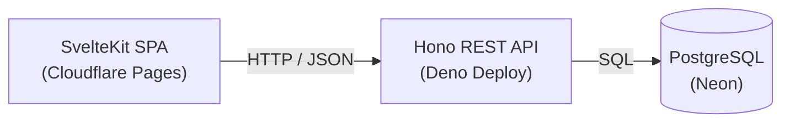

# Reddit clone

A full-stack Reddit-style forum where users create communities, post, comment in threads, and vote. A SvelteKit frontend and a Deno REST API backend with PostgreSQL.

**Try it out:** https://fullstack-reddit-clone-794.pages.dev/


## Background

This started as a project for a full-stack web development course in spring 2026 (most of it follows the course's instructions). After the course ended I kept working on it. Since then I have fixed bugs, added usernames and voting, changed how the client and server stay in sync, and deployed it so it runs online rather than only locally.

I deployed it so it actually runs online, rewrote the backend in TypeScript, added voting and usernames, and spent a long time fixing bugs that only turned up once there was real data and a real server. The point was to get a course exercise to something usable, and to learn the parts the course didn't cover: hosting a multi-service app and debugging it in production.

## What it does

- Register and log in. Passwords are hashed with scrypt; sessions are stateless JWTs sent as Bearer tokens.
- Create communities, then create and delete posts inside them.
- Comment on posts and vote posts and comments up or down. Each user gets one vote per item, and clicking the same arrow again removes the vote.
- A homepage that shows recent posts, each showing its community, author, score, and comment count.

## Tech stack

| Layer | Choice |
|-------|--------|
| Frontend | SvelteKit & Tailwind |
| API | Deno + Hono, TypeScript |
| Database | PostgreSQL |
| Migrations | Flyway |
| Tests | Playwright |
| Local dev | Docker Compose |
| Hosting | Neon, Deno Deploy, Cloudflare Pages |

## Architecture

Three services talk to each other over HTTP and SQL:



The API is layered the way the course taught it: routes call controllers, controllers call repositories, and only the repositories write SQL.

Two things about the data model, in case you read the code:

- Comments are posts. A comment is a row in the `posts` table with a `parent_post_id` pointing at the post it belongs to. One self-referential table instead of two.
- A vote is a row in a `votes` table keyed by `(user_id, post_id)`, with a unique constraint so a user can vote once per item. Deleting a post cascades to its comments and votes.

Authentication is stateless. You log in, get a signed token, and every protected request carries it. The server verifies the signature and keeps no session of its own. Public reads (the homepage, a post) still read your token when it is present, so the API can tell you which way you voted without requiring login to view anything.

## Running locally

You need Docker.

```bash
docker compose up
```

That starts the frontend on `http://localhost:5173`, the API on `http://localhost:8000`, a PostgreSQL container, and the Flyway migrations, which run automatically.

To fill the database with demo content (communities, posts, comments, votes, and a demo user), run the seed script inside the server container:

```bash
docker compose exec server deno run --allow-env --allow-net seed.ts
```

## Testing

There are Playwright end-to-end tests over the main flows (auth, communities, posts, comments, voting). The coverage is light, though, as I mostly wrote them as an exercise to learn how E2E testing works.

```bash
cd e2e-tests && npx playwright test
```


## Possible improvements

- Run the Playwright tests in CI on every push.
- Add role-based access control so community owners can moderate posts and comments, not just their own.
